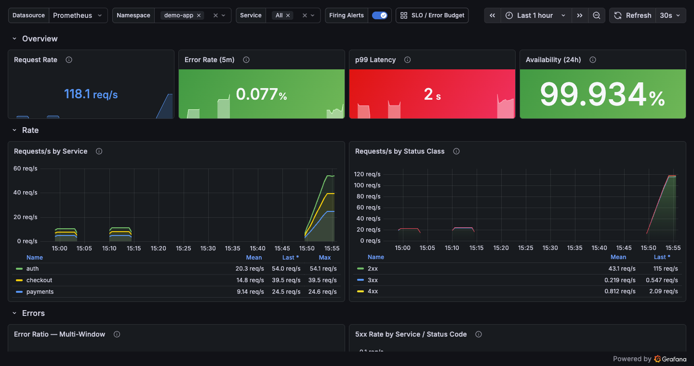
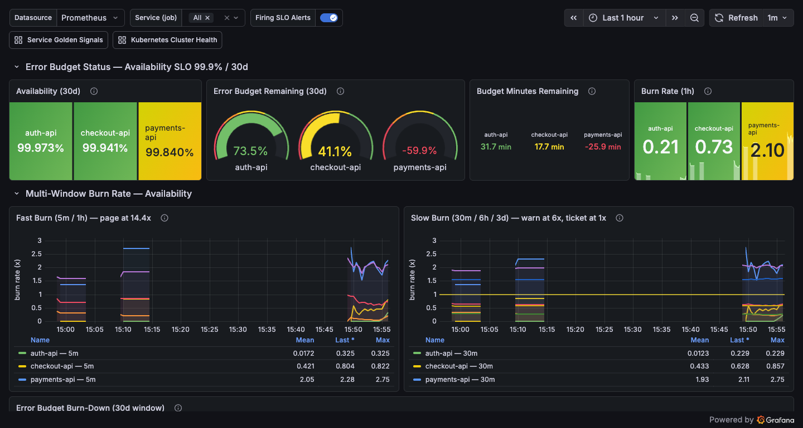
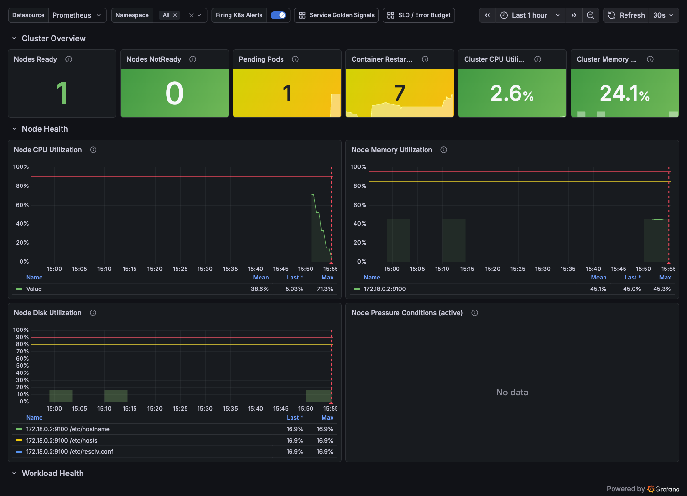

# observability-as-code

> **Complete observability stack as code.** Grafana dashboards, Prometheus alerting rules, recording rules, and Alertmanager configs — all version-controlled, tested, and deployed via CI/CD. Includes an AI-powered alert enrichment layer that adds runbook context and probable causes to every firing alert.

[](LICENSE)
[](https://grafana.com)
[](https://prometheus.io)
[](https://prometheus.io/docs/alerting/latest/alertmanager/)

---

## The Problem with Most Observability Setups

- Dashboards created manually in Grafana UI — no version control, no review, no way to reproduce
- Alert rules written once and never reviewed — alert fatigue from miscalibrated thresholds
- Alerts fire with no context — on-call engineer spends 10 minutes figuring out what the alert even means
- Runbooks live in Confluence, not linked to alerts — engineers miss them under pressure

This repo solves all of the above.

---

## What's Included

### 1. Grafana Dashboards (`dashboards/`)

Production-ready dashboard JSON in `dashboards/json/` (provisioned automatically — see [Deployment](#deployment)) plus Grafonnet sources in `dashboards/*.libsonnet`:

| Dashboard | UID | What it shows |
|-----------|-----|---------------|
| **Service Golden Signals (RED)** | `service-golden-signals` | Rate / Errors / Duration per service: request throughput by service and status class, multi-window error ratio with the 0.1% SLO line, p50/p95/p99 latency quantiles, latency heatmap, and CPU/memory saturation vs limits. Templated by `namespace` and `service`, with firing alerts overlaid as annotations. |
| **Kubernetes Cluster Health** | `kubernetes-cluster-health` | Node CPU/memory/disk utilization with pressure-condition tracking, pod restarts by namespace and top restarting pods, pending/failed pods, degraded deployments, PVC utilization, and cluster capacity headroom (schedulable CPU cores / memory). Built on the recording rules in `recording-rules/kubernetes.yaml`. |
| **SLO / Error Budget** | `slo-error-budget` | Multi-window multi-burn-rate panels matching `alerts/slo.yaml` exactly: fast-burn (5m/1h vs 14.4x), slow-burn (30m/6h/3d vs 6x/1x), 30-day error-budget gauge and burn-down chart, budget-minutes-remaining, and the same policy for the 200ms latency SLO. Includes an on-dashboard reference table explaining the alert policy. |

All three dashboards share a `datasource` template variable, cross-link to each other, use real PromQL against the recording rules in this repo, and annotate firing alerts from the `ALERTS` metric.

#### Dashboards in action

These are live captures from Grafana after importing this repo's JSON into a `kube-prometheus` stack (see [`demo/`](demo/) for the one-command import), with a small instrumented workload driving traffic:

**Service Golden Signals (RED)** — real request rate, error ratio, latency, and availability, broken down by service and status class:



**SLO / Error Budget** — per-service availability against a 99.9% target, error-budget gauges (note `payments-api` burning through its budget), and multi-window fast/slow burn-rate panels straight from the recording rules:



**Kubernetes Cluster Health** — node CPU/memory/disk and cluster capacity from real node-exporter and kube-state-metrics data:



### 2. Alert Rules Library (`alerts/`)

Production-tested Prometheus alerting rules organized by domain:

- `alerts/kubernetes.yaml` — pod crash loops, OOM kills, stuck pods, image pull failures, replica mismatches, stuck rollouts, node health/pressure, PVC capacity
- `alerts/slo.yaml` — multi-window, multi-burn-rate SLO alerts (Google SRE Workbook method): page at 14.4x burn, warn at 6x, ticket at 1x
- `alerts/aws.yaml` — ALB error rate/latency, RDS CPU/storage/connections/replication lag, EC2 status checks, SQS depth and DLQ

Every rule carries `severity` and `category` labels (used by Alertmanager routing) and `summary`/`description`/`runbook` annotations (used by notification templates and the AI enrichment server).

### 3. Recording Rules (`recording-rules/`)

Pre-computed aggregations that make dashboards fast and burn-rate alerting cheap:

```yaml
# recording-rules/slo.yaml
- record: job:request_error_rate:ratio_rate1h
  expr: |
    sum by (job) (rate(http_requests_total{status=~"5.."}[1h]))
    /
    sum by (job) (rate(http_requests_total[1h]))
```

- `recording-rules/slo.yaml` — error/latency ratios across 5m/30m/1h/6h/3d windows + 30d error-budget remaining
- `recording-rules/kubernetes.yaml` — container/namespace/node utilization ratios, workload availability, capacity headroom
- `recording-rules/kubernetes-slo.yaml`, `recording-rules/aws.yaml` — platform and CloudWatch-exporter aggregations

### 4. Alertmanager as Code (`alertmanager/`)

- `alertmanager/alertmanager.yaml` — complete, `amtool check-config`-validated config:
  - **Severity-based routing tree**: `critical` → PagerDuty (10s group wait, 1h repeat) with Slack fan-out; SLO fast-burn → dedicated PagerDuty service with zero group wait; SLO slow-burn → `#slo-burn` Slack; `info` → ticket-class Slack held to **business hours** via `active_time_intervals`
  - **AI enrichment webhook**: critical/warning alerts also fan out to the enrichment server (`max_alerts: 5`, bearer-token auth, firing-only)
  - **Time intervals**: `business-hours` (Mon–Fri 09:00–18:00 America/Denver) gates ticket-class notifications; `weekends` mutes the AWS triage channel while paging routes stay untouched
  - **Inhibition rules**: warnings suppressed while the same alertname/namespace/job is critical; pod-level alerts suppressed while the node is down
- `alertmanager/routes.yaml` + `alertmanager/receivers.yaml` — extended split-file variant with team-based routing (payments/platform/data), FinOps cost-anomaly routing, a dead man's switch on the Watchdog alert, and rollout-aware inhibition
- `alertmanager/templates/slack.tmpl` — severity-colored Slack titles/text with runbook and dashboard buttons

### 5. AI Alert Enrichment (`enrichment-server/`)

An Alertmanager webhook receiver (Go) that intercepts firing alerts and augments them with AI-generated context before posting to Slack:

```
Alert fires: PodCrashLoopBackOff (payments-api)
         │
         ▼
┌────────────────────┐
│  Enrichment Server │
│  (Go webhook)      │
│                    │
│  1. Fetch pod logs │
│  2. Fetch events   │
│  3. Check recent   │
│     deployments    │
└────────┬───────────┘
         │ Claude API
         ▼
Enriched Slack message:
  ⚠ ALERT: PodCrashLoopBackOff
  Service: payments-api | Namespace: production
  ━━━━━━━━━━━━━━━━━━━━━━━━━━━━━━━━━━
  AI Summary: Container exits with code 1 immediately after start.
  Last 10 log lines show "connection refused" to payments-db-primary:5432.
  Recent change: DB failover at 14:23 UTC — new primary endpoint not
  yet reflected in app config. This is a configuration drift issue,
  not an application bug.

  Probable Fix: Restart pods after updating DB_HOST in ConfigMap.
  Runbook: https://runbooks.your-org.com/k8s/db-failover
```

---

## Deployment

### Grafana provisioning (included)

`grafana/provisioning/` contains ready-to-mount provisioning configs:

- `grafana/provisioning/dashboards/observability.yaml` — file provider that loads everything in `dashboards/json/` into an "Observability" folder, hot-reloads on change, and locks UI edits so the repo stays the source of truth
- `grafana/provisioning/datasources/prometheus.yaml` — Prometheus datasource with the stable `prometheus` uid the dashboards reference

**Docker Compose / local:**

```yaml
volumes:
  - ./grafana/provisioning:/etc/grafana/provisioning
  - ./dashboards/json:/var/lib/grafana/dashboards/observability
```

**Kubernetes (kube-prometheus-stack):**

```bash
kubectl create configmap grafana-dashboards-observability \
  --from-file=dashboards/json/ -n monitoring
# then reference via the chart's `dashboardsConfigMaps` value,
# or label the configmap `grafana_dashboard: "1"` for the sidecar loader
```

**Manual import:** Grafana → Dashboards → Import → upload any file from `dashboards/json/`.

### Prometheus & Alertmanager

```bash
# Prometheus: load rule files
rule_files:
  - /etc/prometheus/rules/alerts/*.yaml
  - /etc/prometheus/rules/recording/*.yaml

# Alertmanager: mount config + templates + secrets
kubectl create secret generic alertmanager-secrets \
  --from-literal=slack-webhook-url=... \
  --from-literal=pagerduty-critical-key=... \
  --from-literal=enrichment-server-token=...
```

---

## Validation & Testing

Everything is validated in CI (`.github/workflows/validate-alerts.yaml`) and locally:

```bash
# Alert + recording rule syntax
promtool check rules alerts/*.yaml recording-rules/*.yaml

# Alert behavior unit tests (fire at thresholds, stay quiet when healthy)
promtool test rules tests/rules/*.yaml

# Alertmanager config
amtool check-config alertmanager/alertmanager.yaml

# No local install needed — via docker:
docker run --rm -v "$PWD:/work:ro" --entrypoint /bin/promtool \
  prom/prometheus:v2.53.0 check rules /work/alerts/*.yaml
docker run --rm -v "$PWD:/work:ro" --entrypoint /bin/amtool \
  prom/alertmanager:v0.27.0 check-config /work/alertmanager/alertmanager.yaml
```

Unit tests cover positive **and** negative cases — e.g. `SLOAvailabilityFastBurn` must fire when both the 1h and 5m windows burn hot, and must *not* fire when only the long window is elevated (recovery in progress):

```yaml
# tests/rules/slo_test.yaml
- name: SLOAvailabilityFastBurn does not fire when only 1h window is elevated
  input_series:
    - series: 'job:request_error_rate:ratio_rate1h{job="checkout-api"}'
      values: '0.02 0.02 0.02 0.02 0.02'
    - series: 'job:request_error_rate:ratio_rate5m{job="checkout-api"}'
      values: '0.0005 0.0005 0.0005 0.0005 0.0005'
  alert_rule_test:
    - eval_time: 5m
      alertname: SLOAvailabilityFastBurn
      exp_alerts: []
```

---

## Project Structure

```
observability-as-code/
├── dashboards/
│   ├── json/                       # Provision-ready Grafana dashboard JSON
│   │   ├── service-golden-signals.json
│   │   ├── kubernetes-cluster-health.json
│   │   └── slo-error-budget.json
│   ├── slo-overview.libsonnet      # Grafonnet sources
│   ├── kubernetes-slo.libsonnet
│   └── aws-services.libsonnet
├── grafana/provisioning/           # Grafana dashboard + datasource providers
│   ├── dashboards/observability.yaml
│   └── datasources/prometheus.yaml
├── alerts/                         # Prometheus alerting rules (k8s, SLO, AWS)
├── recording-rules/                # Pre-computed aggregations
├── alertmanager/
│   ├── alertmanager.yaml           # Full config: routing, receivers, inhibition, time intervals
│   ├── routes.yaml                 # Extended team-based routing tree
│   ├── receivers.yaml              # PagerDuty / Slack / webhook receivers
│   └── templates/slack.tmpl        # Slack message templates
├── enrichment-server/              # AI alert enrichment webhook (Go + Claude API)
├── tests/rules/                    # promtool unit tests (all passing)
└── .github/workflows/              # CI: promtool check + test, jsonnet lint, coverage gate
```

---

## Design Notes

**Why multi-window burn rates?** A single-threshold error alert either pages too late (long window) or flaps on blips (short window). Requiring *both* a long and short window to exceed the burn threshold pages fast during real incidents and auto-resolves the moment recovery starts. Thresholds follow the SRE Workbook: 14.4x (2% budget/hour) pages, 6x (5% budget/6h) warns, 1x sustained over 3d files a ticket.

**Why time intervals?** Ticket-class alerts (severity `info`, FinOps anomalies) are held until business hours — Alertmanager queues them rather than dropping them, so nothing is lost and nobody reads a cost-anomaly digest at 3am. Paging routes are never gated.

**Why inhibition?** When a node dies, every pod on it alerts. The `NodeNotReady` → pod-alert inhibition (keyed on `node`) turns a 40-alert storm into one page with full context.

---

## Roadmap

- [x] Kubernetes alerting rules
- [x] SLO burn rate alerts (multi-window)
- [x] Grafana dashboard-as-code (Grafonnet + provision-ready JSON)
- [x] CI validation pipeline
- [x] promtool unit tests for alert rules
- [x] AI alert enrichment server
- [x] Alertmanager routing as code (severity routing, inhibition, time intervals)
- [x] AWS CloudWatch → Prometheus exporter rules
- [ ] Istio service mesh dashboards
- [ ] Automated SLO report generation
- [ ] Terraform module for Grafana provisioning

---

## License

MIT — see [LICENSE](LICENSE).
